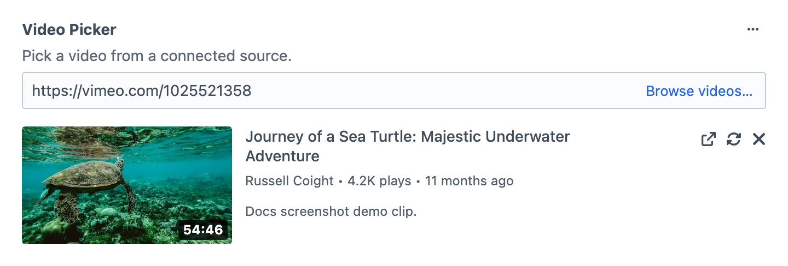
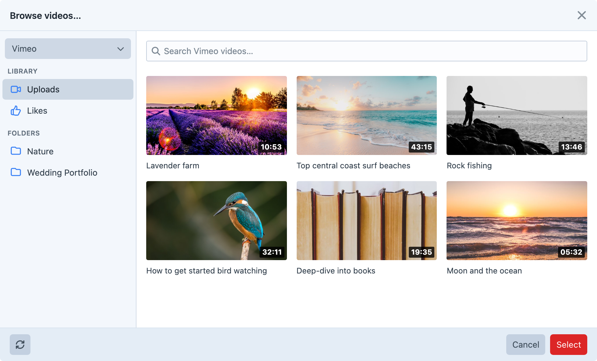

# Videos

Use a Video Picker field when editors need to select a video for an entry. They can browse a connected Source or paste a URL, then check the selection in a preview before saving.

## Field Settings

Create a field under **Settings → Fields**, name it Featured Video and give it the handle `featuredVideo`. Add it to the entry type's field layout. A Source must be enabled, connected and available to this field before editors can select its videos; [Sources](docs:feature-tour/sources) explains that setup.

Enable **Show Explorer** when editors should browse the provider's library, and **Allow URL Input** when they should paste a known URL. Use **Placeholder** for a prompt such as “Paste a product video URL”. **Show Preview** lets editors check their selection, and **Show Provider Icon** identifies the video platform beside it.

For a public product page, enable **Public Videos Only** to exclude private videos from browsing where supported and reject private URL selections. Set **Minimum Duration** and **Maximum Duration** in seconds when the page requires a particular video length; these limits apply when the provider supplies a duration.

**Allow Search** lets editors search in the explorer. Leave **Videos Per Page** blank to use the plugin default, or set a field-specific page size. **Video Sort** orders the videos on the loaded page, so it does not reorder the provider's entire library.

Set **Autoplay**, **Muted**, **Loop** and **Show Controls** for the usual playback behaviour on this field. The provider must support the chosen option, and [template options](docs:template-guides/embedding-videos) can override these defaults for a particular page.

Editors need the **Explore videos** permission under Video Picker in user group permissions to browse or resolve videos in the field. Give the separate **Sources** permission only to people who should manage provider connections.

## Explorer

Open an entry containing the field, open the explorer and choose a Source. Browse a folder or collection, or search for a known video. Select it and check the preview's title and thumbnail.

Save the entry and reopen it to confirm the selection is retained. [Rendering Videos](docs:template-guides/rendering-videos) shows how to display the selected video's details, and [Embedding Videos](docs:template-guides/embedding-videos) adds a player to your page.

## Direct URL

Paste a URL into the field to find a known video without browsing. A URL from a provider with an enabled Source must match a connected Source that is available to the field. Check the preview before saving; a URL from an unavailable Source cannot be selected.

A public URL from a provider without any enabled Source, such as a YouTube link on a site that only connects Vimeo, is resolved through the [generic embed](docs:template-guides/rendering-videos-from-urls#resolve-generic-embed-data) lookup instead. The field accepts it when the provider supplies a player, and keeps the title, author and thumbnail the provider shares. A short link or redirect that leads to a provider with an enabled Source is treated as that provider's URL, so it must match a connected Source. Duration, play counts and private status aren't available for these videos, so the field's duration limits don't apply to them. `getEmbedHtml()` accepts iframe attributes such as `width` and `class` for these videos, while playback defaults like **Autoplay** need a Source. The [embed host allowlist](docs:get-started/configuration#restrict-embed-hosts-in-production) also applies to these URLs.

Provider pages list accepted URL formats and any limitations. For example, a player URL may be accepted even when a private provider-dashboard URL is not.
